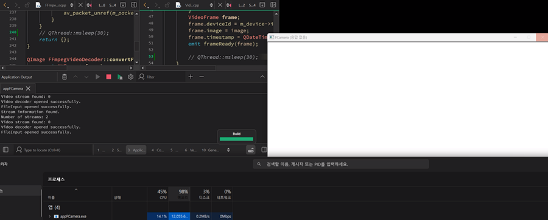
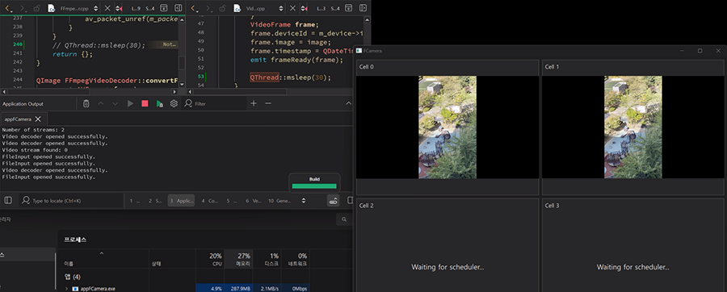
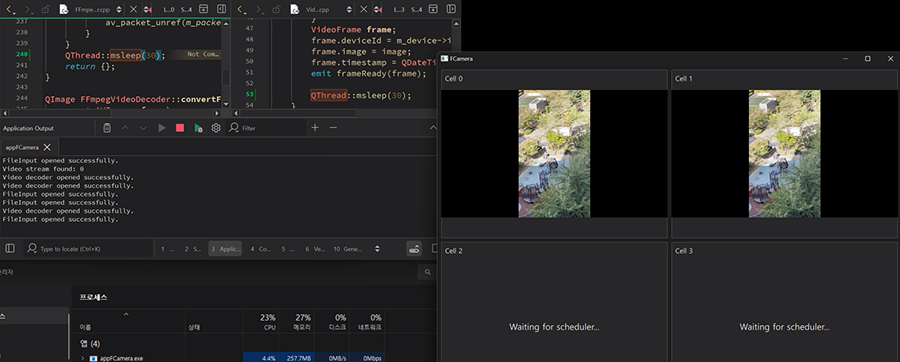

# 목차
1. Qt의 Ownership
2. Worker의 프레임 처리 주기 제한
3. Worker 스레드의 종료 처리

# 

## 1. Qt의 Ownership

### 일자: 2026-10-01

### 관련 파일: main.cpp

### 문제 상황: 종료 시(우측 상단 x버튼 클릭) QT Creator - Applicatioin Output 창에서 terminated abnormally 발생

### 1차 접근(틀림) : 지역 객체의 소멸 순서 변경
오류가 발생한 시점이 프로그램 종료인 점에 근거하여, QQmlApplicationEngine과 QMLImageProvier(QQuickImageProvider을 상속한 커스터 클래스)의 객체 소멸 순서에 문제가 있을 가능성을 의심했습니다.
```
//기존 코드
QQMLApplicatoinEngine engine;
QMLImageProvider imageProvider;
```
cpp의 지역객체는 생성된 역순으로 소멸하기에 engine의 위치를 하단으로 조정하여 imageprovider보다 먼저 소멸되게 유도하였습니다.

->microsoft visualcpp runtime library의 _crtIsValidHeapPointer(block) 오류 발생

#### _crtIsValidHeapPointer
- 지정된 포인터가 CRT(C Runtime Library)가 할당한 heap에 존재하는지 확인합니다.
```
	int _CrtIsValidHeapPointer(
		const void *userData // 할당된 메모리 블록의 시작 주소
	);
```
간단히 말하면, pointer가 allocated heap block에 존재하는지 검사하는 함수
_CrtIsValidHeapPointer(block) 오류는 유효하지 않은 heap pointer가 사용되었을 가능성을 의미합니다.

- 출처 : https://learn.microsoft.com/en-us/cpp/c-runtime-library/reference/crtisvalidheappointer?view=msvc-170

### 2차 접근
_CrtIsValidHeapPointer(block) 오류를 통해 heap을 중심으로 문제에 접근하였습니다.
먼저 QQmlEngine의 공식 문서를 검토하면서 'QQmlEngine는 provider의 소유권을 갖습니다.'라는 특징과 new를 통해 동적 할당하는 예시를 확인하였습니다.
이 시점에서 기존 코드에서 imageprovider 객체를 스택 할당한 방식이 문제의 원인일 것이라는 생각을 하였습니다.

이에 provider 객체를 new를 통해 heap에 할당하도록 코드를 수정하였습니다. 그 결과 오류 없이 정상적으로 실행되었습니다.
- 출처 : https://doc.qt.io/qt-6/ko/qqmlengine.html

### 원인 분석

QQmlEngine이 ownership을 갖는 QMLImageProvider을 stack 객체로 생성한 것이 문제의 주요 원인입니다.
QQmlEngine은 provider 객체를 할당 해제하면서 heap pointer 검사를 실행합니다. 이 과정에서 heap 영역에 존재하지 않는 객체는 _CrtIsValidHeapPointer(block) 오류를 발생시킵니다.
또한, stack 할당된 provider는 cpp 코드에서 scope이 끝나면 소멸자가 호출됩니다. scope 탈출에 의한 스택 해제에서는 CRT heap 검사가 발생하지 않습니다.
provider가 engine보다 아래에서 stack으로 선언된 경우, 소유권을 갖고있는 QQMLEngine은 이미 소멸한 provider 주소에 대해 delete를 시도하고 CRT heap 검사 이전에 terminated abnormally로 프로세스가 종료됩니다.

### 문제 해결
new를 통해 provider 객체를 동적으로 할당하면 cpp에서 소멸자가 호출되지 않기에 Qt로 안전하게 소유권이 이전되며, heap pointer 검사도 문제없이 통과합니다.


## 2. Worker의 프레임 처리 주기 제한
### 일자: 2026-10-10
### 관련 파일: VideoWorker.cpp
### 문제 상황: 실행 화면 미출력 및 Out Of Memory 발생
- 프로그램 실행 시 흰색 화면만 출력되고, 화면 내 오브젝트가 표시되지 않았습니다.
- 실행 도중 모니터가 잠시 검은 화면으로 바뀌고 실행중이던 크롬에서 out of memory 오류가 발생하였습니다.
### 문제 해결 시도
qDebug() 로그를 통해 디코딩이 완료된 이후 다음 프레임 처리 과정에서 프로그램의 동작이 진행되지 않는 현상을 확인했습니다. 이에 다중 디바이스 출력 기능을 추가하면서 발생한 프레임 처리 부하와 메모리 사용량 증가를 의심했습니다.
원인을 좁히기 위해 VideoWorker의 프레임 처리 루프에 QThread::msleep(30)을 적용하고, 디코더에도 동일한 지연을 추가하여 메모리 사용량 변화를 비교했습니다. 또한 VideoWorker에서 각 디바이스의 10초간 프레임 전달 수를 측정했습니다.

### 원인 분석
복수의 Worker가 디코딩된 프레임을 연속적으로 생산하면서 화면 갱신에 부하가 발생하고, 처리 대기중인 프레임으로 인해 메모리 사용량이 증가했을 가능성을 의심하였습니다. 이를 확인하기 위해서, 디코더와 Worker에 지연을 적용하고 메모리 사용량을 확인하였습니다.
 
실험 결과, 지연을 적용하지 않은 경우와 디코더에만 지연을 적용한 경우에는 메모리 사용량이 100%에 도달했습니다. VideoWorker에 30ms 지연을 적용한 조건에서는 메모리 사용량이 27%로 감소했습니다. 반면, VideoWorker의 프레임 처리 루프에 QThread::msleep(30)을 적용하자 메모리 사용량이 27%로 감소했습니다. 이후 디코더에도 동일한 지연을 추가했을 때 메모리 사용량은 약 27%로 유지되었으며, 별도 측정에서는 287MB에서 257MB로 약 30MB 감소했습니다.


<sub>▲ 지연을 적용하지 않은 상태</sub>


<sub>▲ worker에만 지연 적용</sub>


<sub>▲ worker와 디코더에 모두 지연 적용</sub>

이 결과를 통해 디코더 자체의 처리 속도보다 VideoWorker에서 프레임을 요청하고 전달하는 주기가 메모리 사용량에 영향을 준다는 사실을 확인했습니다. 

### 문제 해결
VideoWorker의 프레임 처리 루프에 QThread::msleep(30)을 적용하여 프레임 요청 주기를 제한하였으며, 정상적으로 출력되는 실행 화면과 메모리 사용량을 확인하였습니다. 

## 3. Worker 스레드의 종료 처리
### 일자: 2026-10-10
### 관련 파일: VideoController.cpp, VideoWorker.cpp
### 문제 상황: 프로그램 종료 시 프로세스가 정상적으로 종료되지 않는 문제
- Qt Creator Application Output에 Process unexpectedly did not finish 메시지가 출력되었습니다.
### 문제 해결 시도
지난 커밋 이후 수정한 부분을 중심으로 프로세스와 관계있는 QThread 관련 코드를 점검하였습니다.
스레드를 실행시키는 VideoWorker.cpp와 모든 워커를 관리하는 VideoController.cpp를 확인하고 프로세스 종료를 담당하는 해당 객체들의 소멸자를 확인하였습니다. 

### 원인 분석
VideoController의 소멸자에서는 QThread::quit()을 호출한 뒤 wait()으로 스레드가 종료되기를 기다리고 있었습니다. 
하지만 quit()은 스레드의 이벤트 루프 종료를 요청하는 함수이기에, 실행 중인 VideoWorker::start()의 반복문을 직접 중단하지 않았습니다.
이 반복문은 QThread::isInterruptionRequested()를 확인하도록 작성되어 있었지만, 기존 소멸자에서는 이에 대응하는 requestInterruption()을 호출하지 않았습니다. 때문에 워커의 반복문이 계속 실행되면서 스레드 종료가 지연되었습니다.
### 문제 해결
모든 워커 스레드에 requestInterruption()과 quit()을 호출한 뒤, wait()으로 종료를 기다리도록 VideoController.cpp의 소멸자를 수정하였습니다.
이후 실행에서 모든 워커가 VideoWorker stopped. 로그를 출력하였고, 작성한 qDebug()와 Qt Creator의 finished successfully. 메시지를 통해 프로세스가 정상적으로 종료되었음을 확인하였습니다.
